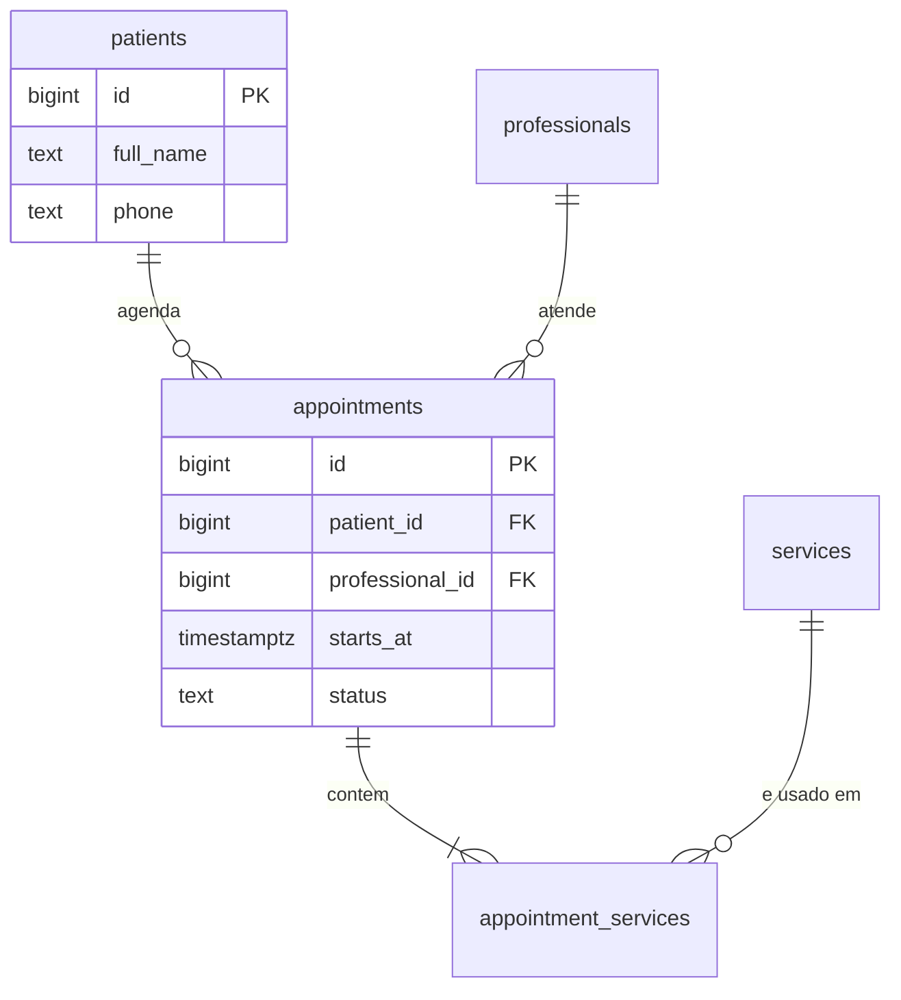

# Modelagem de entidades

> Do texto do produto ao modelo: ache as entidades nos substantivos, desenhe as relações, normalize até a 3ª forma normal e transforme a máquina de estados em coluna.

| | |
|---|---|
| **Referência** | E. F. Codd, "A Relational Model of Data for Large Shared Data Banks" (1970); Eric Evans, "Domain-Driven Design" (2003), entidade, value object e agregado; PostgreSQL Documentation, "Data Definition" (postgresql.org/docs); documentação do Mermaid, Entity Relationship Diagram (mermaid.js.org) |
| **Categoria** | Dados |
| **Tipo** | Prática de modelagem |
| **Vale para** | Bancos relacionais, com exemplos em PostgreSQL; independe de ORM |
| **Verificado em** | 2026-11-24 |

## O que é

Modelar é decidir quais tabelas existem, o que cada uma guarda e como se ligam. O ponto de partida é o texto do produto: histórias e regras de negócio (skill `product`).

- **Entidade:** algo com identidade própria que muda ao longo do tempo. Exemplo: um paciente continua o mesmo paciente se trocar de telefone.
- **Value object** (Evans, DDD): valor sem identidade, comparado pelo conteúdo. Exemplo: um endereço ou um valor em reais. Vira colunas dentro da tabela dona, não tabela própria.
- **Agregado:** grupo de entidades que muda junto e é salvo numa transação só. Exemplo: o agendamento e os itens dele.

## Por que usar

- **Regras viram estrutura:** o banco impede dado inválido, não só o código.
- **Menos retrabalho:** corrigir tabela com dados em produção é caro (ver migrations).
- **Linguagem comum:** o nome da tabela é o nome que o negócio usa.

## Quando usar

- Antes de escrever a primeira tabela de um sistema novo.
- Ao receber uma história que traz um conceito novo.
- Quando uma coluna começa a guardar "vários valores separados por vírgula".

## Para que tipo de projeto

| Tipo de projeto | Encaixe | Por quê |
|---|---|---|
| Site de conteúdo | 🟡 Serve | Poucas entidades; um modelo simples basta |
| MVP de SaaS | ✅ Ótimo | Modelo certo no início evita migração dolorosa depois |
| SaaS em crescimento | ✅ Ótimo | Novas regras exigem entender agregados e relações |
| Sistema interno/corporativo | ✅ Ótimo | Muitas entidades e regras; o modelo é o coração do sistema |
| API/integração | 🟡 Serve | Muitas vezes só guarda o que veio de fora |
| App mobile com backend | ✅ Ótimo | O backend guarda o domínio; o app só consome |
| Script descartável de uma tabela | ❌ Evite | Modelar demais custa mais que o script |

## Quando é bom

- **Substantivos viram entidades:** na história "o paciente agenda uma consulta com um profissional para um serviço", saem `patients`, `appointments`, `professionals`, `services`.
- **Verbos viram relações ou estados:** "agenda" liga paciente a consulta; "cancela" muda o estado.
- **Um fato em um só lugar:** o preço do serviço mora em `services`, não copiado em cada consulta (3ª forma normal).

## Quando é ruim

- **Tabela para tudo:** uma tabela `items` com coluna `type` que guarda coisas diferentes.
- **Lista numa coluna:** `service_ids = '1,2,3'` impede chave estrangeira e consulta simples.
- **Normalizar sem parar:** dez joins para mostrar uma tela. Desnormalize com critério (abaixo).
- **Modelar a tela, não o domínio:** tabela por formulário em vez de por conceito.

## Como começar

**1. Relações.**

- **1:1:** uma linha de A tem uma de B. Raro; use para separar dado opcional ou sensível. Ex.: `professionals` e `professional_profiles` (FK com `unique`).
- **1:N:** a FK fica no lado "N". Um paciente tem várias consultas: `appointments.patient_id`.
- **N:N:** exige tabela de ligação. Uma consulta pode ter vários serviços, e um serviço está em várias consultas: `appointment_services`.

**2. Normalização, de forma simples.**

- **1ª forma:** cada coluna guarda um valor só, sem listas nem colunas repetidas (`phone1`, `phone2`).
- **2ª forma:** em tabela com chave composta, cada coluna depende da chave inteira. Em `appointment_services`, o nome do serviço não deve ficar ali: depende só de `service_id`.
- **3ª forma:** coluna não depende de outra coluna não chave. Se `appointments` guarda `professional_id` e `professional_name`, o nome depende do profissional, não da consulta.

Desnormalize só com medida de lentidão e quando o dado copiado for histórico. Exemplo: `price_cents` copiado do serviço para a consulta, porque o preço de hoje não pode mudar a consulta de ontem.

**3. Estados viram coluna `status`.** Cada estado da máquina de estados vira um valor, com `check` que impede valor fora da lista:

```sql
create table appointments (
  id bigint generated always as identity primary key,
  patient_id bigint not null references patients (id),
  professional_id bigint not null references professionals (id),
  starts_at timestamptz not null,
  status text not null default 'scheduled'
    check (status in ('scheduled', 'confirmed', 'completed', 'canceled', 'no_show'))
);

create table appointment_services (
  appointment_id bigint not null references appointments (id) on delete cascade,
  service_id bigint not null references services (id),
  price_cents integer not null check (price_cents >= 0),
  primary key (appointment_id, service_id)
);
```

As transições permitidas (`scheduled` para `confirmed`, mas não `completed` para `scheduled`) ficam no código ou em regra de negócio, não no `check`.

**4. Diagrama em Mermaid.** Cabe em Markdown e o GitHub renderiza:



Aqui, `appointments` com `appointment_services` forma um agregado: a consulta é a raiz e os serviços mudam com ela.

## Combina com / alternativas

- [Nomes e tipos](02-nomes-e-tipos.md): como nomear colunas e escolher tipos.
- [Chaves e ids](03-chaves-e-ids.md): escolha da chave primária.
- [Auditoria, histórico e soft delete](07-auditoria-historico-soft-delete.md): quando o estado precisa de histórico.
- Skill `product`: regras de negócio e máquina de estados (`skills/product/docs/05-regras-de-negocio.md`).
- Alternativa: banco de documentos (MongoDB) quando o dado é de fato um documento sem relações; para sistema com regras e relações, relacional costuma servir melhor.

## Decisão rápida

- **Use se:** o sistema tem regras de negócio, relações e precisa de integridade.
- **Evite se:** é um protótipo de horas ou um dado sem relação com nada; nesse caso, uma tabela simples basta.
