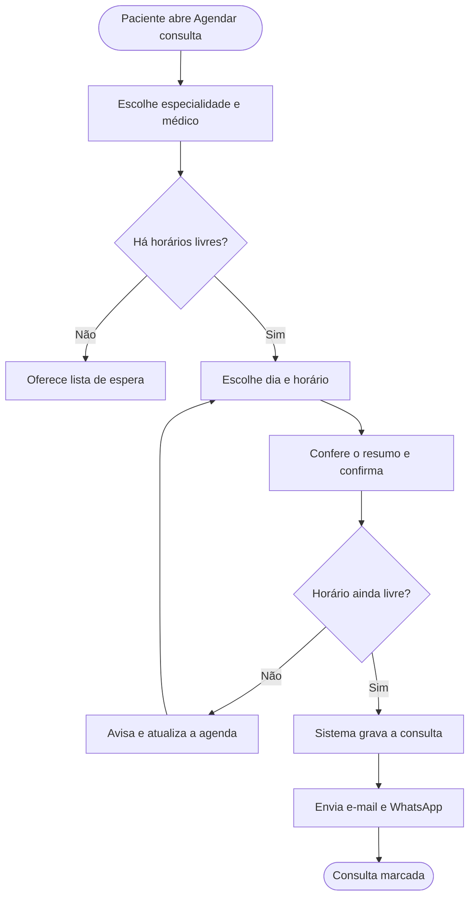

# Fluxos e jornadas

> Desenhe o caminho que a pessoa percorre, passo a passo, com os desvios e os estados de tela, antes de escrever histórias e código.

| | |
|---|---|
| **Referência** | Jeff Patton, "User Story Mapping" (O'Reilly, 2014); Mermaid, documentação de flowchart (mermaid.js.org) |
| **Categoria** | Produto |
| **Tipo** | Prática de descoberta e especificação |
| **Vale para** | Qualquer sistema com telas ou etapas; o diagrama em Mermaid funciona em GitHub, GitLab e na maioria dos editores de Markdown |
| **Verificado em** | 2026-11-24 |

## O que é

Fluxo é a sequência de passos que uma pessoa faz para cumprir um objetivo no sistema. Jornada é o fluxo visto de ponta a ponta, inclusive o que acontece fora da tela (um WhatsApp, um lembrete, uma ligação).

Para cada passo, anote três coisas:

- **Quem faz:** paciente, recepcionista, o próprio sistema.
- **O que vê:** a tela, a mensagem, o botão.
- **O que o sistema faz:** valida, grava, envia e-mail, cobra.

Além do fluxo principal (o caminho feliz), descreva:

- **Fluxos secundários:** outros jeitos de chegar ao mesmo objetivo, como remarcar ou cancelar.
- **Caminhos de erro e exceção:** o que acontece quando algo dá errado, como horário já ocupado ou pagamento recusado.
- **Estados de tela:** vazio, carregando, erro e sem permissão.

Story mapping (Jeff Patton, 2014) coloca a jornada em uma linha no topo, da esquerda para a direita, e as funcionalidades de cada etapa embaixo. Assim se vê o todo e se fatia por prioridade: a primeira fatia horizontal é o menor sistema que ainda cumpre a jornada.

## Por que usar

- **Todo mundo vê o mesmo sistema:** cliente, dev e designer discutem o mesmo desenho.
- **Acha buracos cedo:** o "e se der errado?" aparece no papel, não em produção.
- **Base das histórias:** cada passo e cada desvio viram história com critério de aceite.
- **Fatiar fica fácil:** o mapa mostra o que entra no MVP e o que fica para depois.

## Quando usar

- Depois da entrevista e do escopo, antes de escrever histórias.
- Quando o pedido do cliente é vago ("quero um sistema de agendamento").
- Quando há mais de uma pessoa envolvida no mesmo processo (paciente e recepção).
- Antes de desenhar telas, para saber quais telas existem.

## Para que tipo de projeto

| Tipo de projeto | Encaixe | Por quê |
|---|---|---|
| Site/landing | 🟡 Serve | Fluxo curto (chegar, ler, clicar no WhatsApp ou formulário); basta um parágrafo |
| MVP de SaaS | ✅ Ótimo | Ajuda a achar o menor caminho que entrega valor e a cortar o resto |
| SaaS em crescimento | ✅ Ótimo | Mostra onde novas funcionalidades se encaixam e quais fluxos já têm erro mal tratado |
| Sistema interno | ✅ Ótimo | Processo existe no papel ou na planilha; mapear evita automatizar o que já era ruim |
| API/integração | 🟡 Serve | Troque telas por chamadas: quem chama, o que envia, o que recebe, o que falha |
| App mobile | ✅ Ótimo | Estados de tela e falta de rede mudam muito a experiência |
| Script ou automação de uma tarefa só | ❌ Evite | Não há jornada; entrada, regra e saída bastam |

## Quando é bom

- **Passo com ator claro:** cada linha diz quem age.
- **Erro tratado no desenho:** cada passo importante tem seu "e se falhar?".
- **Linguagem do cliente:** "paciente escolhe o horário", não "usuário dispara POST".
- **Diagrama pequeno:** um fluxo por objetivo, em uma tela de leitura.
- **Estados de tela listados:** ninguém descobre a tela vazia só no fim.

## Quando é ruim

- **Fluxo gigante num diagrama só:** vira parede ilegível. Quebre por objetivo.
- **Só o caminho feliz:** o sistema funciona na demonstração e quebra com o primeiro cliente real.
- **Desenhar tela em vez de fluxo:** cor e posição de botão são decisão de design, não de fluxo.
- **Documento que ninguém atualiza:** fluxo desatualizado engana mais do que ajuda.
- **Mapear tudo antes de construir:** mapeie o necessário para a próxima fatia.

## Como começar

Passo 1: escolha um objetivo e escreva o fluxo principal em texto numerado.

```markdown
## Fluxo: paciente agenda uma consulta

Objetivo: o paciente marca uma consulta com um médico da clínica.
Quem participa: paciente, sistema.
Pré-condição: paciente com conta e logado.

1. Paciente abre "Agendar consulta".
   - Vê: lista de especialidades.
   - Sistema: carrega as especialidades ativas.
2. Paciente escolhe a especialidade e o médico.
   - Vê: médicos da especialidade com o próximo horário livre.
   - Sistema: busca médicos com agenda aberta.
3. Paciente escolhe dia e horário.
   - Vê: calendário com horários livres.
   - Sistema: bloqueia o horário por 5 minutos.
4. Paciente confere o resumo e confirma.
   - Vê: médico, data, hora, endereço da clínica.
   - Sistema: grava a consulta e libera o bloqueio.
5. Paciente vê a confirmação.
   - Vê: "Consulta marcada" e botão "Adicionar ao calendário".
   - Sistema: envia e-mail e WhatsApp de confirmação.

Desvios e erros:
- 2a. Nenhum médico com agenda aberta: mostrar "Sem horários nesta especialidade" e oferecer lista de espera.
- 3a. Horário ocupado por outra pessoa no meio do caminho: avisar e voltar ao passo 3 com a agenda atualizada.
- 4a. Falha de rede ao confirmar: manter os dados na tela e oferecer "Tentar de novo".
- 4b. Paciente já tem consulta no mesmo horário: avisar e voltar ao passo 3.

Estados de tela:
- Vazio: sem consultas ainda, mostrar "Você ainda não tem consultas" com botão de agendar.
- Carregando: esqueleto da lista de horários.
- Erro: mensagem clara e botão de tentar de novo.
- Sem permissão: recepcionista sem acesso à agenda do médico vê "Você não tem acesso a esta agenda".
```

Passo 2: desenhe o mesmo fluxo em Mermaid (flowchart) e cole no markdown.

````markdown

````

Passo 3: monte o story mapping em uma tabela. A linha de cima é a jornada; as linhas de baixo, as funcionalidades por prioridade.

```markdown
| Jornada     | Entrar           | Agendar           | Ser lembrado     | Remarcar/cancelar |
|-------------|------------------|-------------------|------------------|-------------------|
| MVP         | Login com e-mail | Escolher horário  | E-mail           | Cancelar          |
| Depois      | Login com Google | Lista de espera   | WhatsApp         | Remarcar          |
| Mais tarde  |                  | Pagamento online  | Pesquisa pós-consulta |              |
```

## Combina com / alternativas

Combina com:
- [Escopo do MVP](02-escopo-do-mvp.md): o mapa mostra o que cortar.
- [Histórias e critérios de aceite](04-historias-e-criterios-de-aceite.md): cada passo e cada desvio viram história.
- [Regras de negócio](05-regras-de-negocio.md): "bloquear o horário por 5 minutos" é regra, registre à parte.
- [Backlog e ordem de construção](06-backlog-e-ordem-de-construcao.md): cada fatia do mapa vira um bloco do backlog.
- [Design systems](../../design-systems/SKILL.md) e [Experiência do usuário](../../user-experience/SKILL.md): depois do fluxo, vem o layout e a adaptação por dispositivo.

Alternativas e complementos: diagrama de sequência (bom para integrações entre sistemas), BPMN (mais formal, comum em processos de empresas grandes), user journey map (foca em emoção e dor da pessoa, não em passos do sistema).

## Decisão rápida

- **Use se:** o sistema tem mais de uma tela ou etapa, mais de um tipo de pessoa, ou o pedido ainda está vago.
- **Evite se:** a tarefa é uma única ação sem desvios, ou se o fluxo só vai existir para enfeitar um documento.
