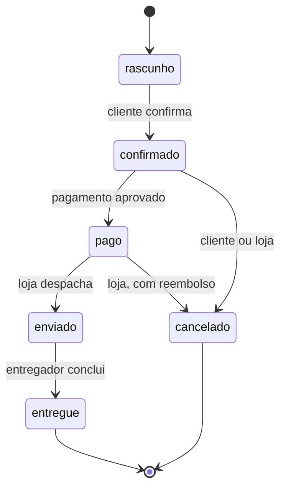

# Regras de negócio

> Escreva cada regra do negócio com um id, uma frase e um exemplo real, e desenhe os estados de cada entidade antes de programar.

| | |
|---|---|
| **Referência** | Specification by Example (Gojko Adzic, 2011); Example Mapping (Matt Wynne, Cucumber, 2015, cucumber.io); Domain-Driven Design, linguagem ubíqua (Eric Evans, 2003); UML, diagrama de estados; Mermaid, stateDiagram (mermaid.js.org) |
| **Categoria** | Produto |
| **Tipo** | Prática de descoberta e especificação |
| **Vale para** | Qualquer sistema com decisões do negócio; o diagrama usa Mermaid, que o GitHub renderiza |
| **Verificado em** | 2026-11-24 |

## O que é

Regra de negócio é uma decisão do cliente que o sistema precisa respeitar. Não é tela nem tecnologia. É o "pode / não pode" do dia a dia da empresa.

Tipos comuns de regra:

- **Permissão:** o que pode e o que não pode ("só cliente com cadastro agenda").
- **Limite:** máximo e mínimo ("até 3 reagendamentos").
- **Cálculo:** como se chega a um valor ("frete = R$ 5 + R$ 1 por km").
- **Prazo:** quanto tempo vale ("cancelamento grátis até 2 horas antes").
- **Aprovação:** quem decide ("desconto acima de 10% precisa do gerente").

Cada regra ganha um id curto (RN-01) e um exemplo com números. Entidades que mudam de situação (pedido, agendamento) ganham também uma máquina de estados: a lista de estados, das mudanças permitidas, de quem pode fazer cada uma e quando.

Três ideias ajudam a achar e escrever regras:

- **Specification by Example** (Adzic, 2011): especificar com exemplos reais, que viram critério de aceite e teste.
- **Example Mapping** (Wynne, 2015): numa conversa de 25 minutos, monte cartões: história, regras, exemplos e perguntas em aberto.
- **Linguagem ubíqua** (Evans, 2003): usar as palavras do cliente, as mesmas na conversa, nos documentos e no código.

## Por que usar

- **Menos retrabalho:** regra descoberta antes de programar não vira bug depois.
- **Todos entendem igual:** o exemplo com números acaba com o "eu achei que...".
- **Base dos testes:** cada regra com exemplo vira um teste.
- **Fácil de validar:** o cliente confere a tabela sem ler código.

## Quando usar

- Antes de escrever as histórias de aceite ([04](04-historias-e-criterios-de-aceite.md)).
- Quando aparece cálculo, prazo, limite ou aprovação.
- Quando algo "muda de situação" (pedido, pagamento, agendamento).
- Quando dois clientes dizem coisas diferentes sobre a mesma coisa.

## Para que tipo de projeto

| Tipo de projeto | Encaixe | Por quê |
|---|---|---|
| Site/landing | ❌ Evite | Quase não há regra; uma lista de pedidos do cliente basta |
| MVP de SaaS | ✅ Ótimo | Poucas regras bem escritas evitam construir a coisa errada |
| SaaS em crescimento | ✅ Ótimo | Planos, limites e exceções se acumulam e precisam de registro |
| Sistema interno | ✅ Ótimo | O processo da empresa é feito de regras e aprovações |
| API/integração | 🟡 Serve | Vale para regras de validação e estados; o resto é contrato técnico |
| App mobile | 🟡 Serve | As regras são as mesmas do backend; escreva uma vez só |

## Quando é bom

- **Regra curta:** uma frase, uma decisão.
- **Exemplo com números:** "pedido de R$ 80 com frete R$ 8 dá R$ 88".
- **Palavras do cliente:** se ele diz "diária", o código não diz `dailyRate2`.
- **Casos de borda perguntados:** "e se...?" faz aparecer o que ninguém lembrou.
- **Cliente valida:** ele lê, corrige e aprova.

## Quando é ruim

- **Regra vaga:** "o sistema deve ser seguro". Não dá para testar.
- **Regra sem dono:** ninguém sabe quem decide quando ela muda.
- **Documento enorme:** ninguém lê, e ele fica velho. Mantenha só o que vale.
- **Regra misturada com tela ou código:** "o botão fica cinza" não é regra.
- **Termos trocados:** pedido, ordem e compra para a mesma coisa.
- **Estado demais:** 15 estados para um fluxo simples. Comece com os que o cliente realmente distingue.

## Como descobrir

1. Pegue um caso real do cliente: uma planilha, um WhatsApp, um pedido de ontem.
2. Pergunte "e se...?": e se atrasar, cancelar, pagar errado, chegar duas vezes?
3. Pergunte "quem decide?" e "até quando?".
4. Peça um exemplo com números para cada regra.
5. Anote as palavras do cliente em um glossário e use só elas.
6. Marque o que ficou sem resposta como pergunta em aberto.

## Como começar

Tabela de regras (exemplo de agendamento), copie e adapte:

```markdown
| Id | Regra | Exemplo | Quem decide | Status |
|---|---|---|---|---|
| RN-01 | Cliente cancela sem custo até 2 horas antes do horário. | Corte às 15h; cancelou às 12h50: sem custo. | Dono do salão | Confirmada |
| RN-02 | Cancelamento com menos de 2 horas cobra 50% do serviço. | Serviço de R$ 80; cancelou às 14h: cobra R$ 40. | Dono do salão | Confirmada |
| RN-03 | Cada cliente tem no máximo 2 agendamentos futuros. | Já tem 2 marcados: o 3º é recusado com aviso. | Dono do salão | Confirmada |
| RN-04 | Horários não se sobrepõem para o mesmo profissional. | João às 14h por 1h: ninguém marca João às 14h30. | Regra do negócio | Confirmada |
| RN-05 | Falta sem aviso 3 vezes bloqueia novos agendamentos. | Pergunta em aberto: bloqueia por quanto tempo? | A definir | Aberta |
```

Máquina de estados em tabela (exemplo de pedido de delivery):

```markdown
| De | Para | Quem pode | Quando | Regra |
|---|---|---|---|---|
| rascunho | confirmado | Cliente | Tem ao menos 1 item e endereço | RN-10 |
| confirmado | pago | Sistema (gateway de pagamento) | Pagamento aprovado | RN-11 |
| confirmado | cancelado | Cliente ou loja | Antes do pagamento | RN-12 |
| pago | enviado | Loja | Pedido preparado | RN-13 |
| pago | cancelado | Loja | Com reembolso total | RN-14 |
| enviado | entregue | Entregador | Cliente recebeu | RN-15 |
| entregue, cancelado | (nenhum) | Ninguém | Estados finais | RN-16 |
```

O mesmo em Mermaid (o GitHub desenha o diagrama):

````markdown

````

Cartões do Example Mapping (uma história por rodada):

```markdown
História: cliente cancela um agendamento
- Regra RN-01: grátis até 2 horas antes
  - Exemplo: corte às 15h, cancelou às 12h50, sem custo
- Regra RN-02: depois disso cobra 50%
  - Exemplo: R$ 80, cancelou às 14h, cobra R$ 40
- Pergunta: e se o profissional cancelar? Quem paga?
```

Dica: dê ao exemplo o formato Dado/Quando/Então quando for virar critério de aceite.

## Combina com / alternativas

Combina com:
- [Entrevista com o cliente](01-entrevista-com-o-cliente.md): de onde vêm os casos reais.
- [Escopo do MVP](02-escopo-do-mvp.md): decide quais regras entram agora.
- [Fluxos e jornadas](03-fluxos-e-jornadas.md): cada passo do fluxo pode ter uma regra.
- [Histórias e critérios de aceite](04-historias-e-criterios-de-aceite.md): o exemplo vira Dado/Quando/Então.
- [Backlog e ordem de construção](06-backlog-e-ordem-de-construcao.md): regras de que outras dependem vêm primeiro.
- [Onde registrar](07-onde-registrar.md): onde guardar a tabela.

Onde a regra mora no código fica para as skills architecture e dados.

Alternativas e complementos: tabela de decisão (para muitas combinações de condições), BDD completo com Gherkin, glossário do domínio.

## Decisão rápida

- **Use se:** o sistema tem cálculo, prazo, limite, aprovação ou algo que muda de situação.
- **Evite se:** o projeto é só conteúdo, sem decisão do negócio.
